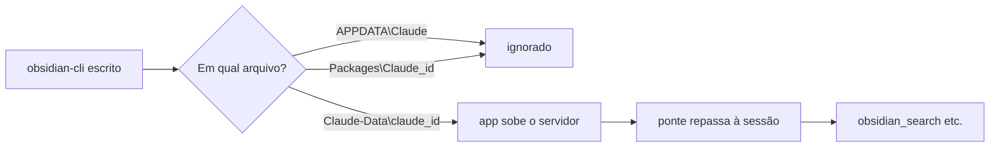

# 🐞 Obsidian CLI via MCP não carrega

> [!tldr] Em uma linha
> O servidor MCP `obsidian-cli` não chegava às sessões porque o Claude Desktop lê a configuração num terceiro caminho, achado pelo botão "Editar configuração".

## Contexto
- Os `CLAUDE.md` dos cofres mandam buscar **pela Obsidian CLI**, que usa o índice do app (aliases, tags, backlinks). Ver [[Guia do cofre para IA]].
- A sessão do Claude roda na nuvem, ligada ao meu computador Windows pelo Claude Desktop. O shell dessa sessão é uma VM Linux isolada que só monta as pastas conectadas: ele **não alcança** executáveis do Windows nem o app do Obsidian.
- Caminho correto: um servidor MCP local no Claude Desktop, que roda no Windows, chama a CLI e é repassado à sessão pela ponte com o computador. O servidor é o `Modelos/Orquestra/obsidian-cli-mcp.js` (Node, sem dependências, só leitura): ferramentas `obsidian_search`, `obsidian_read`, `obsidian_backlinks` e `obsidian_help`.

## Sintoma
- Esperado: as ferramentas `obsidian_*` aparecem na sessão (prefixo `mcp__remote-devices__obsidian-cli__`).
- Observado: nenhuma ferramenta do Obsidian; no shell, `obsidian` não existe; em Configurações → Desenvolvedor do Claude Desktop, **"Nenhum servidor adicionado"**, mesmo com o `obsidian-cli` escrito em `claude_desktop_config.json`.
- Sinal paralelo: `The CLI is unable to find Obsidian. Please make sure Obsidian is running and try again.` quando o app está fechado.

## Impacto
- Os agentes buscavam sem a CLI (busca direta nos `.md`), sem o índice de aliases e backlinks. O diário de 2026-10-28 do stonebid registra isso.

## Hipóteses
(as descartadas ficam, com o motivo)
1. ❌ O shell da sessão roda a CLI. **Descartada:** VM Linux, sem `/mnt/c`, sem `cmd.exe` nem `powershell.exe`; `which obsidian` vazio.
2. ❌ A CLI está desativada no Obsidian. **Descartada:** Configurações → Sobre → Avançado → "Interface de linha de comando" estava ligada (Obsidian 1.14.5).
3. ⚠️ O Obsidian estava fechado. **Verdadeira, mas secundária:** causava o erro "unable to find Obsidian"; com o app aberto, `obsidian version` respondeu. Não explicava o servidor ausente.
4. ❌ O servidor `obsidian-cli-mcp.js` está quebrado. **Descartada:** teste manual por stdio respondeu `initialize`, `tools/list`, `obsidian_search` e `obsidian_backlinks`.
5. ❌ O app lê `%APPDATA%\Claude\claude_desktop_config.json` (caminho da documentação). **Descartada:** gravado ali, a tela seguiu vazia.
6. ❌ O app lê a pasta do pacote da Microsoft Store (`%LOCALAPPDATA%\Packages\Claude_pzs8sxrjxfjjc\LocalCache\Roaming\Claude`). **Descartada:** era onde o `obsidian-cli` já estava; a pasta tem o marcador `.user-data-left` (dados que o app deixou para trás).
7. ✅ O app lê **`%LOCALAPPDATA%\Claude-Data\claude_pzs8sxrjxfjjc\claude_desktop_config.json`**. Causa raiz.

## Linha do tempo técnica
(2026-10-28, horário de Brasília)
- 21:57: teste inicial. Sem MCP do Obsidian na sessão e sem CLI no shell.
- 22:07: script de setup. Obsidian fechado; o arquivo de `%APPDATA%\Claude` não existia e foi criado (com um pacote `npx` redundante, depois removido).
- 22:08: achada a config da pasta da Store, já com o `obsidian-cli`.
- 22:17: conferido que a CLI está ativada no Obsidian.
- 22:18: com o app aberto, `obsidian version` = 1.14.5 e busca OK.
- 22:20: servidor testado por stdio: OK.
- 22:22: Desenvolvedor mostra "Nenhum servidor adicionado".
- 22:24: "Editar configuração" abre `Claude-Data\claude_pzs8sxrjxfjjc`.
- 22:26: entrada gravada ali, app reiniciado pela bandeja: `obsidian-cli` "Em execução" e ferramentas na sessão.

## Pseudocódigo do problema
```
config_documentada = %APPDATA%\Claude\claude_desktop_config.json
config_da_store    = %LOCALAPPDATA%\Packages\Claude_<id>\LocalCache\Roaming\Claude\...   # abandonada (.user-data-left)
config_real        = %LOCALAPPDATA%\Claude-Data\claude_<id>\claude_desktop_config.json

app.iniciar():    servidores = ler(config_real).mcpServers   # vazio
sessão.iniciar(): ferramentas += ponte.repassar(servidores)   # nenhuma obsidian_*
agente:           sem CLI -> busca nos .md, sem índice
```



## Testes feitos
- `which obsidian` e `ls /mnt/c` no shell da sessão: nada.
- Script PowerShell (rodado por duplo clique em `.cmd`): `obsidian version`, `obsidian vault="stonebid-vault" search query="lance"`, versão do Node, leitura e escrita das configs com backup.
- Teste do servidor por stdio com 4 mensagens JSON-RPC.
- Tela Configurações → Desenvolvedor antes e depois de cada mudança.

## Evidências encontradas
- O botão **"Editar configuração"** abriu o Explorador em `C:\Users\Ylderlan\AppData\Local\Claude-Data\claude_pzs8sxrjxfjjc`.
- Depois de gravar nesse arquivo e sair pela bandeja: `obsidian-cli` **Em execução** na tela Desenvolvedor.
- Na sessão: `obsidian_search` achou notas no `stonebid-vault` ("lance") e no `Vault` ("commit").

## Correção aplicada
Entrada gravada no arquivo real (backup antes, JSON sem BOM):
```json
{
  "mcpServers": {
    "obsidian-cli": {
      "command": "node",
      "args": ["C:\\Users\\Ylderlan\\Documents\\Projetos\\the-mind-hub\\Vault\\Modelos\\Orquestra\\obsidian-cli-mcp.js"],
      "env": { "OBSIDIAN_BIN": "C:\\Program Files\\Obsidian\\Obsidian.com" }
    }
  }
}
```

## Solução
1. Nunca adivinhar o caminho: em Configurações → Desenvolvedor, clicar **"Editar configuração"** e editar o arquivo que ele abre.
2. Reiniciar o Claude Desktop **saindo pela bandeja** (botão direito → Sair); fechar a janela não basta.
3. Deixar o Obsidian aberto: a CLI só responde com o app rodando.
4. Abrir um chat novo: as ferramentas entram quando a sessão carrega.

## Como validar que não voltou
- Configurações → Desenvolvedor: `obsidian-cli` com status "Em execução".
- Na sessão: `obsidian_search` com `vault="Vault"` devolve notas.
- No PowerShell do Windows: `obsidian version` responde.

## Logs que deveriam existir
- Botão "Ver registros" do `obsidian-cli` na tela Desenvolvedor (log do servidor). A pasta `%APPDATA%\Claude\logs` não tinha logs de MCP; os logs devem estar junto da config real em `Claude-Data` [a confirmar].
- Uma linha no stderr do `obsidian-cli-mcp.js` ao iniciar, com `OBSIDIAN_BIN` e a versão da CLI, ajudaria a diagnosticar mais rápido (melhoria sugerida, ainda não feita).

## O que aprendi
- No Windows, o Claude Desktop pode guardar a config fora do caminho documentado. **A fonte da verdade é o botão "Editar configuração".**
- Arquivo de config com o servidor certo não prova nada: só a tela Desenvolvedor mostra se o app leu.
- Testar o servidor isolado (stdio) separa "servidor quebrado" de "app não leu a config" em um passo.
- PowerShell 5 grava UTF-8 **com BOM** em `Set-Content -Encoding utf8`; para JSON de config, gravar sem BOM.

> [!tip] Quando abrir esta nota
> Quando a busca pela Obsidian CLI falhar numa sessão: ferramentas `obsidian_*` ausentes, `obsidian` não encontrado ou "unable to find Obsidian".

### 🔗 Conexões
- Mapa: [[MOC Programação]]
- Relacionadas: [[Guia do cofre para IA]], [[Atualizar a memória]], [[Modelo de CLAUDE do cofre]]
- Projeto onde aconteceu: stonebid, nota `bug-obsidian-cli-mcp-nao-carrega-2026-10-28` em `orquestra/bugs/` do `stonebid-vault`
