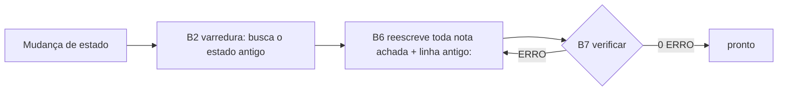

# 🐞 Estado anterior preservado em outras notas depois de uma mudança

> [!tldr] Em uma linha
> Bug de **processo** dos agentes no Obsidian: a cada mudança de fato, regra ou decisão, só a nota dona era atualizada, e as outras seguiam com o estado antigo (às vezes com um aviso "vale o novo" por cima). Aconteceu mais de 10 vezes; a correção foi no processo, com um portão no `cofre.py verificar`.

## Contexto
- A memória do projeto mora em notas que se citam: contexto, decisões, notas `contrato-*`, MOC, diário.
- Toda escrita segue as Etapas vitais B ([[manual-da-orquestra]]). Até aqui, B2 era "buscar antes: a nota existe?" e B6 "propagar" listava só roteiro, contexto, diário e decisão substituída.
- O `cofre.py verificar` checava links, frontmatter, nomes, grafia e tamanho. Não sabia que um estado tinha sido substituído.

## Sintoma
- Esperado: depois de uma mudança, toda nota diz a mesma coisa, só no estado atual.
- Observado: notas com o estado antigo ou com duas versões ao mesmo tempo. Exemplos, todos de 2026-10-29:
  - Prazo: "4 dias" no corpo de 8 notas `contrato-*` e no [[geral-contexto]], com o aviso "Onde esta nota fala em 4 dias, vale o prazo novo" por cima.
  - Testes: hub com T-01 a T-06 contra T-01 a T-11 em [[contrato-testes]] (resolvido em [[geral-decisao-2026-10-29-testes-no-escopo]]).
  - MCP: campo Alteração de [[geral-decisao-2026-10-29-camada-mcp]] com a api_key "só nas tools com autenticação", o contrário do corpo.
  - Comprovante: [[contrato-modelo-de-dados]], 8.1 de [[contrato-arquitetura]], RF-51 e Q-09 com três versões do que o comprovante guarda.
  - Cancelamento: tabela 5.1 contra RF-22 e RN-12 ([[geral-decisao-2026-10-29-cancelamento-ao-vivo]]).
  - [[contrato-pontos-para-validar]]: "Q-09 respondida" no topo e "nenhuma pergunta respondida" no fim.
  - [[contrato-tecnologias]]: tabela da v0.2 toda "[A PREENCHER]" e, logo abaixo, outra com tudo decidido.
  - Hub [[contrato-do-projeto]]: "as notas de seção guardam o texto da v0.2; onde divergem, vale a v0.3".

## Impacto
- Um agente que lê uma nota só (o que a ordem de leitura incentiva) pega o estado errado e implementa ou decide em cima dele.
- O humano gastou várias rodadas apontando divergência por divergência; a limpeza das 12:15 não bastou: às 13:55 o portão novo ainda achou **19 ERRO em 11 notas**.

## Hipóteses
1. ❌ Descuido pontual do agente: descartada. Mais de 10 casos, em sessões e assuntos diferentes, com o mesmo formato.
2. ❌ Falta de regra contra duplicar nota: já existia ("atualizar em vez de duplicar"). Ela evita nota nova, não estado velho em nota que já existe.
3. ✅ O processo não tinha **varredura de impacto**: B2 procurava a nota a escrever, não as notas que citam o estado que mudou.
4. ✅ Havia um padrão de escrita que **institucionaliza** a ambiguidade: o aviso de prevalência e a regra "notas `contrato-*` copiam a v0.2 sem reinterpretar".
5. ✅ Nenhuma checagem determinística: o `verificar` não tinha como saber que "4 dias" virou estado antigo.

## Linha do tempo técnica
(2026-10-29)
- 09:06: prazo muda para 24 horas; avisos "Prazo mudou" entram por cima de 6 notas.
- 12:04: v0.3 só no hub; notas de seção mantidas na v0.2.
- 12:15: limpeza manual pedida pelo humano em 10 notas.
- 12:25, 13:13, 13:19, 13:31: novas divergências apontadas (testes, MCP, comprovante, cancelamento), cada uma resolvida com um aviso "Mudança M-xx" por cima do texto velho.
- 13:47: humano pede a correção do processo e o registro deste bug.
- 13:55: portão novo no `verificar` acusa 19 ERRO em 11 notas; notas reescritas no estado atual; 0 ERRO.

## Pseudocódigo do problema
```
mudança(fato):
    nota_dona.atualizar(fato.novo)          # B4
    propagar(roteiro, contexto, diário)     # B6: lista fixa, sem busca
    # outras notas que citam fato.antigo: nunca visitadas
    # às vezes: nota.prepend("onde fala em antigo, vale novo")
verificar(): links, nomes, grafia -> 0 ERRO    # não conhece fato.antigo
```

## Testes feitos
- `verificar` com as linhas `antigo:` contra o cofre antes da correção: 19 ERRO em 11 notas (estado antigo e aviso de prevalência).
- O mesmo `verificar` contra diário, bug, decisão `substituida`, seções "Histórico"/"Mudanças" e os campos Proposta, Alteração e Motivo: nenhum falso positivo.
- Depois da reescrita: 0 ERRO no `stonebid-vault` e no `Vault`.

## Evidências encontradas
- Os avisos repetiam a mesma forma: "Onde esta nota fala em X, vale Y; o texto segue como estava".
- Os casos apareceram em notas **não** listadas em B6 (referências, MOC, hub), nunca nas listadas.
- O próprio portão achou um resquício fora do que a busca manual mostrou ([[contrato-glossario]]) e a regra nova citando a frase proibida.

## Correção aplicada
- **Processo** (original no Vault, chega aqui por `cofre.py sincronizar`): B2 virou "buscar antes e **varrer o impacto**" (estado antigo, sinônimos, inglês, números e backlinks da nota dona); B6 reescreve no estado atual cada nota da varredura e registra o estado antigo; B7 checa. Regra "Uma versão só" no Manual da Orquestra §7, no Modelo de CLAUDE do cofre, no `CLAUDE.md` deste cofre e do Vault, em "Atualizar a memória" e no checklist do Manual do Cérebro.
- **Ferramenta:** o bloco `padroes` aceita `antigo: termo => estado atual (nota dona)`. O `verificar` dá ERRO em termo `antigo:` e em aviso de prevalência fora dos lugares de histórico.
- **Notas:** 18 notas reescritas no estado atual; notas `contrato-*` passam a ter só o texto vigente, e [[contrato-do-projeto-mudancas]] vira o histórico de versões.

## Solução
- Uma versão só: nota de estado diz só o agora; cronologia só em diário, bug, decisão `substituida` e seções de histórico.
- Toda mudança de estado deixa uma linha `antigo:`: o erro não volta sem o `verificar` acusar.

## Como validar que não voltou
- `python orquestra/modelos/cofre.py verificar .` com zero ERRO depois de cada escrita.
- Toda mudança de estado no diário tem os termos varridos e as notas tocadas; e uma linha `antigo:` nova no bloco `padroes`.

## Logs que deveriam existir
- No diário: "Varredura: termos X, Y; notas tocadas A, B".
- Saída do `verificar`: "estado substituído '<termo>'" ou "aviso de prevalência".

## O que aprendi
- Atualizar a nota dona não basta: o estado antigo mora onde ele foi **citado**, e só uma busca acha.
- Aviso "vale o novo" por cima de texto velho não resolve ambiguidade: ele **é** a ambiguidade.
- Regra sem checagem determinística volta a falhar; com a linha `antigo:`, a regra vira portão.

> [!tip] Teste de utilidade
> Sem abrir o código, dá para entender: esperado vs. observado, hipóteses descartadas, o que provou a causa raiz, a correção e como validar? Diagramas `mermaid` são bem-vindos.



### 🔗 Conexões
- Funcionalidade: [[geral-contexto]]
- Decisões: [[geral-decisao-2026-10-29-testes-no-escopo]], [[geral-decisao-2026-10-29-camada-mcp]], [[geral-decisao-2026-10-29-comprovante-e-hash]], [[geral-decisao-2026-10-29-cancelamento-ao-vivo]]
- Outros bugs: [[bug-obsidian-cli-mcp-nao-carrega-2026-10-28]]
- Projeto: [[geral-contexto]]
- Regras: [[manual-da-orquestra]]
- Sessão: [[diario-2026-10-29-varredura-de-impacto]]
- Lição geral: "Atualizar a memória" e "Manual da Orquestra" (no Vault)
